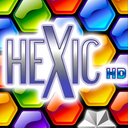

<h1 align=center>Hexic HD: Nintendo Switch port</h1>

<b>hexichd-nx 1.0.0</b> · <a href="https://chanseyisthebest.github.io/hexichd-nx-installer/">web installer</a> · <a href="https://github.com/ChanseyIsTheBest/hexichd-nx/releases/tag/v1.0.0">release</a>

An unofficial native port of the Xbox Live Arcade game **Hexic HD** (Carbonated Games and Microsoft, 2005) with its
Title Update 1, made by static recompilation with [ReXGlue](https://github.com/rexglue/rexglue-sdk) and drawn by
[reNut](https://github.com/masterspike52/reNut)'s renderer on deko3d. No emulator.

This repository contains no game files. You need your own copy of the game: the Xbox 360 package
(`Content/<profile>/584107D1/000D0000`) **and its Title Update 1** (`Content/0000000000000000/584107D1/000B0000`).

## Playing it on the Switch

1. Open the web installer: **https://chanseyisthebest.github.io/hexichd-nx-installer/**
2. Add your game and Title Update 1 (each as its package file or an extracted folder) and press
   **Create hexichd-nx.zip**. It all runs in your browser.
3. Extract `hexichd-nx.zip` into `sdmc:/switch/`.
4. Start it with a game override (hold **R** while starting an installed title) or a forwarder.

To update, open the installer again, add the game and Title Update 1, press **Create hexichd-nx-update.zip** and
extract it over your folder (your `hexichd.toml` and saves stay).

Features:

- Native Switch renderer (reNut's, on deko3d); drawn at 1280x720, shown at 720 handheld and 1080 docked.
- Runs at the console's stock clocks on three cores; PGO + LTO build.
- Language follows the Switch's, or set `language` (english, japanese, french, german, spanish, italian, korean,
  tchinese, portuguese).
- Face buttons by position as on the Xbox 360 pad (Switch B = Xbox A, A = B, Y = X, X = Y); `input_xbox_layout = false`
  for by letter. Single Joy-Cons held sideways, one per player; button mapping in `[input_p1]`.

Your options are in `hexichd.toml` next to the NRO; delete it and the game writes the default one again.

Warnings:

- Album applet mode does not give the game enough memory. A forwarder must be set to a **39-bit address space**.
- The first time you play after installing or updating it can stutter for a moment on new screens while shaders
  compile; later sessions start smoothly.

## Building

Windows, LLVM clang and the VS Build Tools for the PC build; devkitA64, libnx and deko3d from
[devkitPro](https://devkitpro.org) for the Switch; Python; and your own copy of the game for the code generator and the
shaders. Steps in [docs/building.md](docs/building.md). `pgo/` holds the release's branch profile (collected in the
Ryujinx emulator).

More: [docs/hexichd-notes.md](docs/hexichd-notes.md) (the port step by step),
[docs/optimising-functions.md](docs/optimising-functions.md), [docs/codegen-crash-fixes.md](docs/codegen-crash-fixes.md),
[docs/progress-log.md](docs/progress-log.md).

## Credits and license

- **Carbonated Games and Microsoft**: Hexic HD. This is an unofficial fan-made port with no affiliation.
- **ChanseyIsTheBest**: this port.
- **[Tom Clay](https://github.com/rexglue/rexglue-sdk)**: the ReXGlue SDK, built on the work of the
  **[Xenia](https://xenia.jp)** team.
- **[StevensND](https://github.com/StevensND/nfsmw-nx)**: nfsmw-nx, the SDK's Switch layer and much of the method; and
  [nfsmw-nx-installer](https://github.com/StevensND/nfsmw-nx-installer), which the installer page is built on.
- **[nebadasSwifty](https://github.com/nebadasSwifty/masseffect-nx)**: masseffect-nx.
- **[hedge-dev](https://github.com/hedge-dev/XenosRecomp)**: XenosRecomp; shaders also go through DXC, SPIRV-Cross and
  banjo-nx's passes.
- **reNut and [masterspike52](https://github.com/masterspike52/reNut)**: reNut's Direct3D-level renderer, reused with
  its author's permission (as the Banjo-Kazooie: Nuts & Bolts port adapted it).
- **[plume](https://github.com/renderbag/plume)** (from UnleashedRecomp), **[deko3d](https://github.com/devkitPro/deko3d)**
  and **[uam](https://github.com/devkitPro/uam)** by fincs, with SwitchWakerHD's uam patches.
- **[devkitPro](https://devkitpro.org) and [switchbrew](https://github.com/switchbrew/libnx)**: devkitA64 and libnx.
- The ports this one builds on and takes fixes from: [katamari-nx](https://github.com/ChanseyIsTheBest/katamari-nx)
  (this port's base); [renut-nx](https://github.com/ChanseyIsTheBest/renut-nx) (banjo-nx),
  [pacman-nx](https://github.com/ChanseyIsTheBest/pacman-nx), vivapinata-nx, halo3-nx, rr6-nx (this XDK's device layout
  and the shadow objects), [feedingfrenzy-nx](https://github.com/ChanseyIsTheBest/feedingfrenzy-nx) (version 0x0E
  shader containers), [peggle1-nx](https://github.com/ChanseyIsTheBest/peggle1-nx),
  [sa2-nx](https://github.com/ChanseyIsTheBest/sa2-nx), [battd_nx](https://github.com/ChanseyIsTheBest/battd_nx),
  [bejeweled3-nx](https://github.com/ChanseyIsTheBest/bejeweled3-nx) and the zuma ports; **NetherSX2_nx** by NaGaa95
  (the four-core layout, MIT); and **Ridge Racer 6 Recomp** by Sirhalo23 (its BSD notice stays on anything taken from it).
- **[KhronosGroup](https://github.com/KhronosGroup/SPIRV-Cross)**: SPIRV-Cross.
- The other libraries in [THIRD_PARTY_NOTICES.md](THIRD_PARTY_NOTICES.md).

No affiliation with Microsoft or Nintendo. This repository contains no game files and no code generated from the game.
The released NRO holds the game's recompiled code but none of its data files; everything else made from your copy is
made on your own computer. Running homebrew needs custom firmware, which violates Nintendo's ToS and can get a console
banned.

GPL-3.0 (see [LICENSE](LICENSE)); the SDK keeps its BSD-3-Clause license (see
[THIRD_PARTY_NOTICES.md](THIRD_PARTY_NOTICES.md)).
